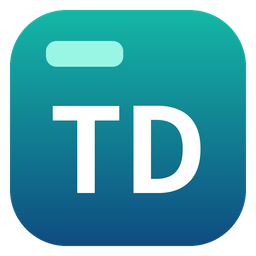
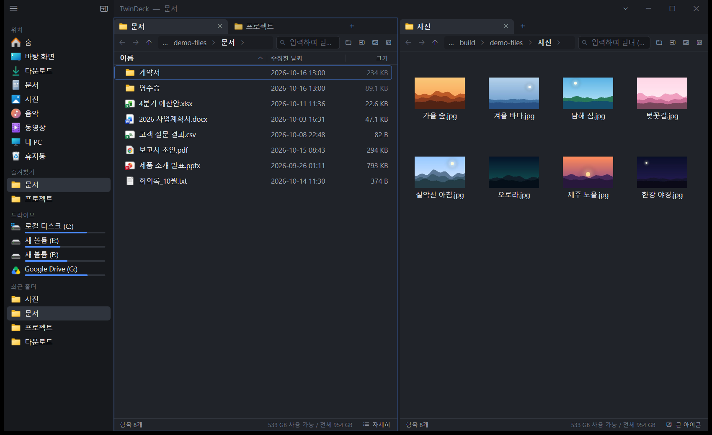
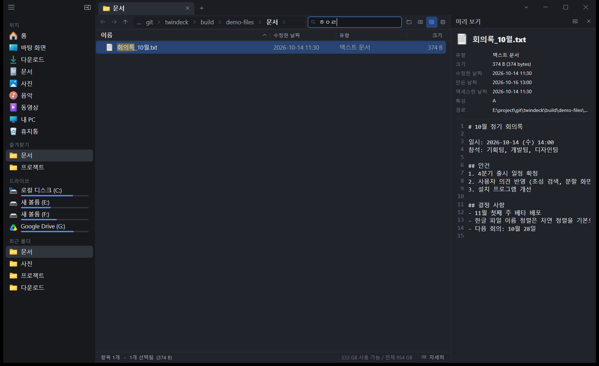
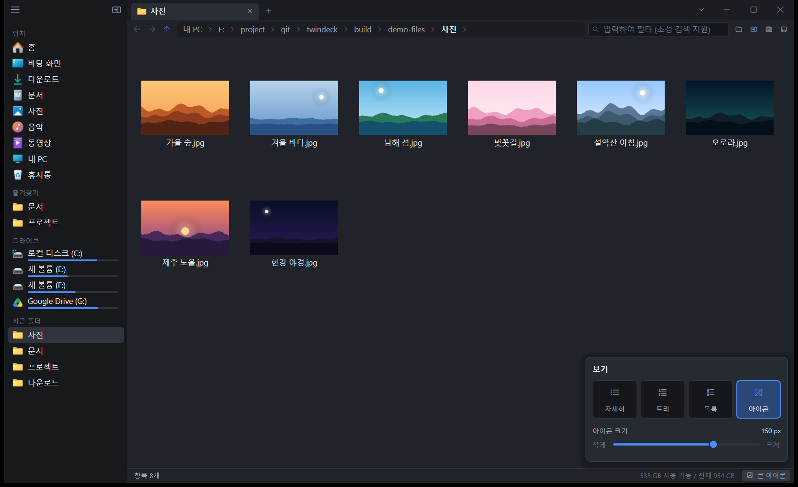
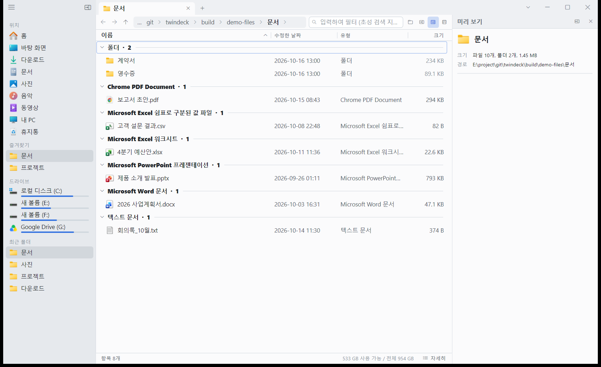
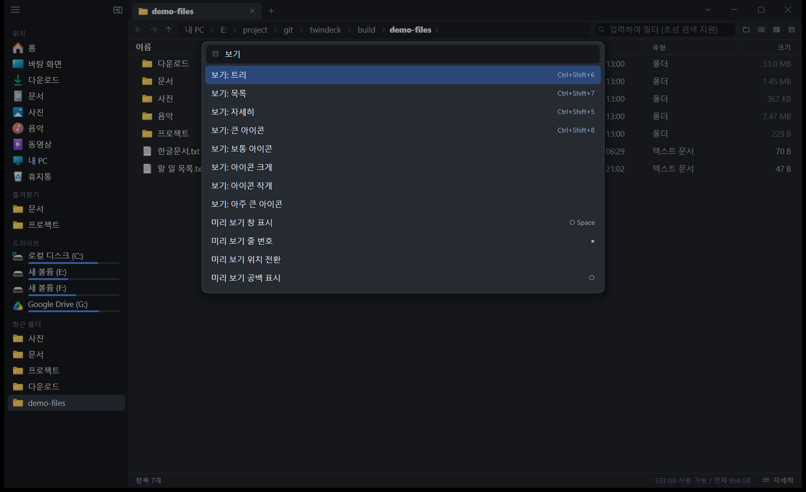
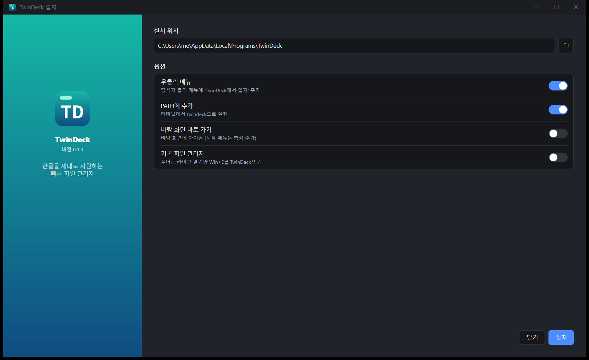

<h1 align="center">
   TwinDeck
</h1>

<p align="center">
  <a href="https://github.com/corbyhan/twindeck/releases/latest"></a>
  <a href="https://github.com/corbyhan/twindeck/releases"></a>
  
  
</p>

<p align="center">
  <strong>한글을 제대로 지원하는 빠른 Windows 파일 관리자</strong><br/>
  탭과 분할 화면, 초성 검색, 썸네일 보기, 원드라이브 동기화 상태까지 — 약 1MB짜리 실행 파일 하나로.
</p>

<h3 align="center">
  <a href="https://github.com/corbyhan/twindeck/releases/latest/download/TwinDeck-Setup.exe"><ins>TwinDeck 다운로드</ins></a>
</h3>
<p align="center">
  <sub>Windows 10 / 11 (64비트) · 관리자 권한 불필요 · 설치 없이 쓰려면 <a href="https://github.com/corbyhan/twindeck/releases/latest/download/TwinDeck-portable.zip">포터블 zip</a></sub>
</p>

<p align="center">
  
</p>

## 기능

<table>
<tr>
<td width="45%" valign="middle">

### 한글 우선

파일 이름을 **초성**으로 찾습니다. `ㅎㅇㄹ`만 쳐도 `회의록_10월.txt`가 걸립니다. 입력 중인 한글 조합이 입력란 안에 바로 보이고, 목록에서 바로 타이핑하면 필터가 됩니다. 텍스트 미리 보기는 UTF-8 / UTF-16 / **CP949(EUC-KR)** 를 자동으로 구분합니다.

</td>
<td width="55%"></td>
</tr>
<tr>
<td width="45%" valign="middle">

### 보기 모드와 썸네일

자세히 · 트리 · 목록 · 아이콘(48–256px)을 상태 표시줄 버튼이나 `Ctrl+휠`로 바꿉니다. 아이콘 보기에서는 사진·동영상·문서 썸네일을 보이는 것만 백그라운드로 불러옵니다. 보기는 탭마다 따로 기억합니다.

</td>
<td width="55%"></td>
</tr>
<tr>
<td width="45%" valign="middle">

### 그룹화와 미리 보기

이름(초성)·유형·크기·날짜로 묶고, 미리 보기 창에서 폴더 통계와 텍스트·이미지를 바로 확인합니다. 다크 / 라이트 / 시스템 테마와 미카·아크릴 배경 효과를 고를 수 있습니다.

</td>
<td width="55%"></td>
</tr>
<tr>
<td width="45%" valign="middle">

### 명령 팔레트

`Ctrl+Shift+P`로 모든 기능을 한글이나 영어로 검색해 실행합니다. `Ctrl+P`로 폴더 이동, 주소 표시줄은 `Tab` 자동 완성을 지원합니다.

</td>
<td width="55%"></td>
</tr>
<tr>
<td width="45%" valign="middle">

### 간단한 설치

설치 파일을 실행해 위치와 옵션(우클릭 메뉴, PATH, 바탕 화면 바로 가기, 기본 파일 관리자)을 고르면 끝입니다. 현재 사용자에게만 설치되고, 제거하면 바꾼 설정을 모두 되돌립니다.

</td>
<td width="55%"></td>
</tr>
</table>

### 그 밖의 기능
- `NtQueryDirectoryFile` 기반의 빠른 폴더 열거, 폴더 크기 병렬 계산(SSD/HDD/네트워크별로 켜고 끄기)
- 탭, 상하·좌우 분할 패널, 트리 펼치기, 하위 폴더 재귀 검색
- 원드라이브 등 클라우드 폴더의 "상태" 열 (온라인 전용 ☁ / 이 디바이스에서 사용 가능 ✓ / 동기화 중) — 온라인 전용 파일은 미리 보기 때문에 내려받지 않음
- Windows `IFileOperation` 기반 복사·이동·삭제(진행 표시, 실행 취소), 휴지통 보기·복원, 셸 우클릭 메뉴, 드래그 앤 드롭
- 즐겨찾기, 사용 빈도 기반 최근 폴더, 창·분할·탭 세션 복원, 폴더 변경 자동 감지
- 한국어 / 영어 UI (자동 감지)

## 설치
1. [**TwinDeck-Setup.exe**](https://github.com/corbyhan/twindeck/releases/latest/download/TwinDeck-Setup.exe)를 내려받아 실행합니다.
2. 설치 위치와 옵션을 고르고 **설치**를 누릅니다.

> 코드 서명이 없어서 처음 실행할 때 Windows SmartScreen이 "PC 보호" 창을 띄울 수 있습니다. **추가 정보 → 실행**을 누르면 됩니다.

| 옵션 | 내용 |
|---|---|
| 설치 위치 | 기본값 `%LOCALAPPDATA%\Programs\TwinDeck`. 바꾸면 이전 위치는 정리합니다 |
| 우클릭 메뉴 | 탐색기 폴더·빈 곳 메뉴에 "TwinDeck에서 열기" 추가 |
| PATH에 추가 | 터미널에서 `twindeck`으로 실행 |
| 바탕 화면 바로 가기 | 바탕 화면에 아이콘 생성 (시작 메뉴 바로 가기는 항상 생성) |
| 기본 파일 관리자 | 폴더·드라이브 열기와 `Win+E`를 TwinDeck으로 연결 |

- 설치 후에는 옵션 → 시스템 → "설치 설정…" 또는 Windows 설정 → 앱 → TwinDeck → 수정에서 다시 바꿀 수 있습니다.
- 제거하면 위 항목을 모두 되돌리고 설정과 즐겨찾기(`%LOCALAPPDATA%\TwinDeck`)는 남겨 둡니다.
- **포터블**: [TwinDeck-portable.zip](https://github.com/corbyhan/twindeck/releases/latest/download/TwinDeck-portable.zip)을 풀어 실행하면 설정을 같은 폴더에 저장하고 시스템은 건드리지 않습니다.
- **무인 설치**: `TwinDeck-Setup.exe --install [--dir=경로] [--desktop] [--default] [--no-menu] [--no-path] [--quiet]`, 제거: `TwinDeck.exe --uninstall [--quiet]`

## 주요 단축키
| 키 | 동작 |
|---|---|
| `Ctrl+Shift+P` / `F1` | 명령 팔레트 |
| `Ctrl+P` | 폴더로 이동 |
| `Ctrl+L`, `Alt+D` | 주소 표시줄 편집 |
| `Ctrl+F` / 바로 입력 | 필터 (초성 지원) |
| `Ctrl+Shift+F` | 하위 폴더에서 검색 |
| `Ctrl+T` / `Ctrl+W` / `Ctrl+Shift+T` | 새 탭 / 탭 닫기 / 닫은 탭 다시 열기 |
| `Ctrl+\` / `Ctrl+Shift+\` | 오른쪽 / 아래쪽으로 분할 |
| `Space`, `Ctrl+I` | 미리 보기 창 |
| `F2`, `Delete`, `Shift+Delete` | 이름 바꾸기, 휴지통, 영구 삭제 |
| `Ctrl+Shift+N` | 새 폴더 |
| `Alt+←/→/↑`, `Backspace` | 뒤로 / 앞으로 / 위로 |
| `→` / `←` | 폴더 펼치기 / 접기 |
| `Ctrl+Shift+5/6/7/8`, `Ctrl+휠` | 자세히 / 트리 / 목록 / 큰 아이콘, 아이콘 크기 조절 |
| `Ctrl+,` | 옵션 |

단축키는 `TwinDeck-UserData.json`의 `Hotkeys` 배열(`{"Keys": "Ctrl+K", "Command": "NewTab"}`)에서 바꿀 수 있습니다.

## 데이터 위치
`%LOCALAPPDATA%\TwinDeck\` 아래에 다음 파일과 폴더가 저장됩니다.
- `TwinDeck-Config.json`, `TwinDeck-UserData.json`, `TwinDeck-Session.json`
- `Logs\`

exe 파일 옆에 `TwinDeck-Config.json`이 있으면 포터블 모드로 동작해 그 폴더에 저장합니다.

## 직접 빌드
요구 사항: Visual Studio 2022 Build Tools (C++ 데스크톱), Windows 10 SDK 이상

```bat
build.bat            :: release → build\TwinDeck.exe, build\TwinDeck-Setup.exe
build.bat debug
```


- 아이콘: Pillow가 설치된 Python으로 `python tools\make_icon.py`
- 태그(`v*`)를 push하면 GitHub Actions가 빌드해서 릴리스에 `TwinDeck-Setup.exe`와 포터블 zip을 올립니다 (`.github/workflows/release.yml`).
- README 스크린샷: `python tools\make_demo.py && python tools\shots.py` (예시 파일과 별도 설정 폴더를 써서 내 파일이 찍히지 않음)

## 구조
| 파일 | 역할 |
|---|---|
| `src/main.cpp` | WinMain, WndProc, IME 메시지, 렌더 루프 |
| `src/app.*` | 상태 모델: 패널 트리, 탭, 행 생성, 탐색 |
| `src/ui.cpp`, `popups.cpp`, `inspector.cpp` | 즉시 모드 UI |
| `src/input.cpp` | 키보드, 텍스트 편집, IME, 필터 |
| `src/fs.*` | NT 디렉터리 열거, 폴더 크기 계산, 변경 감시 |
| `src/shell.*` | 아이콘, 파일 작업, 클립보드, 셸 메뉴, 휴지통, 드래그 앤 드롭 |
| `src/render.*` | D3D11 스왑체인과 Direct2D/DirectWrite |
| `src/commands.cpp` | 명령과 단축키 정의 |
| `src/settings.*`, `json.*` | 설정 저장 |
| `src/i18n.*` | 한국어/영어 문자열 |
| `src/install.cpp` | 설치와 탐색기 통합 |
| `tools/` | 개발용 스크립트: 아이콘 생성, 스크린샷, 입력 자동화, 크래시 덤프 분석 |

## 라이선스
[MIT](LICENSE)
